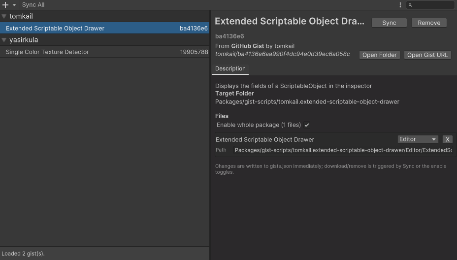

# 切换 Target Root

## 两个可选根目录

- `Packages/gist-scripts`（默认）—— gist 放在 `Packages/` 下，作为 **嵌入式包**（`com.gistscripts.gists`）。根目录自动生成唯一 `package.json`，整个文件夹是一个 UPM 包。
- `Assets/GistScripts` —— gist 放在 Assets 下，作为普通工程资产。

## 切换方式

**Edit → Project Settings → MUD → Gist Manager → Target Root**

弹出的三个按钮：

- **切换并移动** — 把清单、`package.json` 嵌入包标记、所有 gist 目录树（包括 `.cs`、`.meta`、asmdef、子目录）整体搬到新根；搬完清空旧根并删除。
- **仅切换（不移动）** — 只改清单里的 `targetRoot`，磁盘一个文件不动——警告：「下次 Sync 会重新下载整体内容；旧位置脚本会被重新下载再下出来 → 同名 asmdef 产生工程无法编译的状态」
- **取消** — 零改动

## 安全栏

- 目标目录**同名**（同 `packageDir`）且**非空** → 拒绝；目标根已有 `gists.json` / `package.json` 及其 `.meta` → 拒绝 → **零改动**
- 搬运中途 IO 出故障 → **回滚**：已搬的全部挪回去，清单不动
- 成功后自动 `PackageManager.Client.Resolve()` 通知 UPM 重解析 → 新嵌入式包**立即**出现在 UPM 里，不需要手动 Ctrl+R

## 切换后的表现

- **Packages → Assets**：`com.gistscripts.gists` 从 UPM 消失；文件原地不动，像工程里普通脚本一样工作。
- **Assets → Packages**：`com.gistscripts.gists` 回到 UPM；嵌入式包自动恢复；不需要手动刷新。
